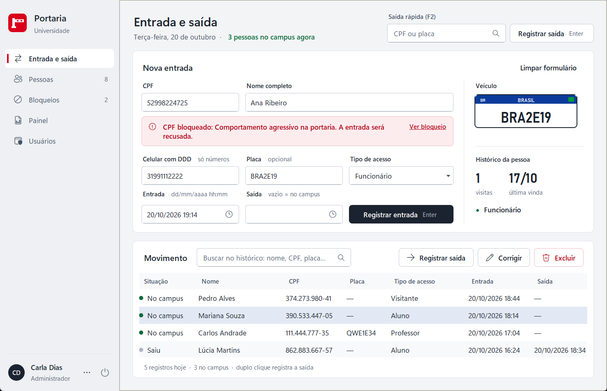
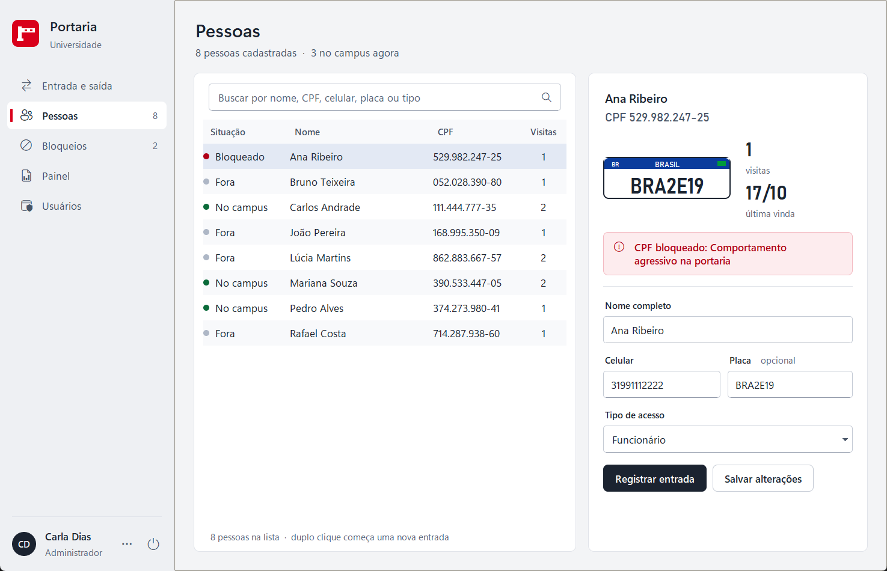
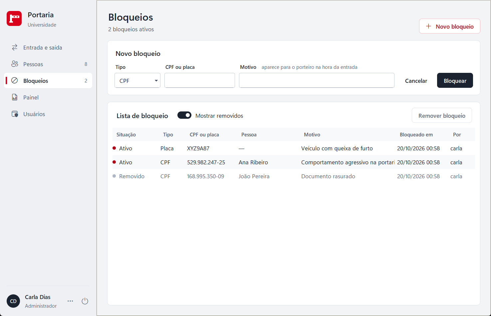
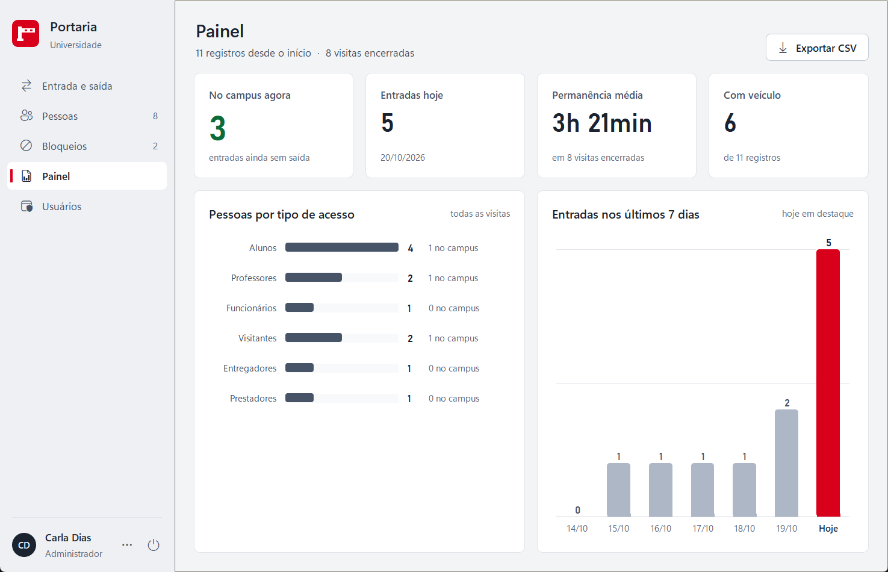
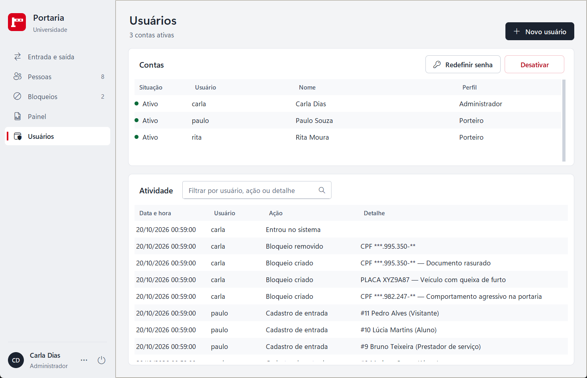
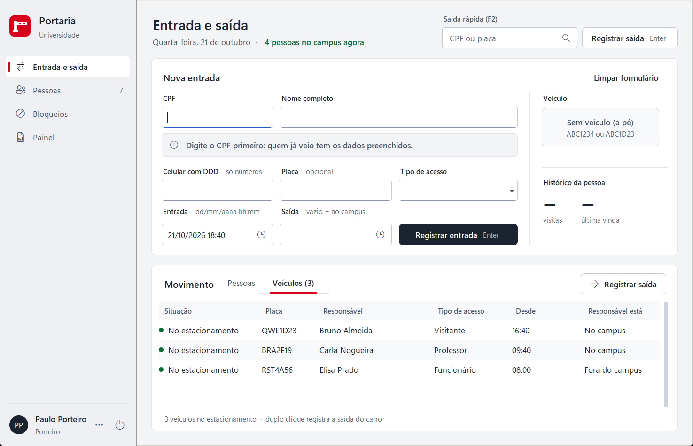

# Sistema de Portaria da Universidade

Projeto da disciplina **Teoria da Computação e Compiladores** (8º período — UNA).
Controle de entrada e saída de pessoas no campus, feito em Python com Tkinter, e
relacionado com as fases de um compilador (léxica, sintática e semântica).

**Versão atual: 2.0** (a 2.1 está em desenvolvimento neste ramo) — veja [Versões](#versões).


## Como executar

**Sem instalar nada:** baixe o `Portaria.exe` na página de
[Releases](https://github.com/Kauhan33/sistema-portaria/releases), coloque numa
pasta e abra. O banco, os backups e o log são criados ao lado do `.exe`.

**Pelo código-fonte:** requer só o Python 3 (Tkinter já vem na instalação padrão
do Windows).

```bash
python portaria_universidade.py
```

### Gerar o executável

```bash
pip install pyinstaller
python build_exe.py
```

Gera `dist/Portaria.exe` (arquivo único, sem janela de console, com o ícone da
cancela). O PyInstaller só é necessário para gerar o `.exe`; o programa continua
usando apenas a biblioteca padrão. O ícone fica em `assets/portaria.ico`
(`assets/gerar_icone.py` refaz o ícone, se o símbolo mudar).

Os registros ficam no banco SQLite `portaria.db` (módulo `sqlite3`, já incluso
no Python), criado ao lado do programa. Se houver um `registros_portaria.json` da
versão 1 na mesma pasta, ele é importado na primeira execução e renomeado para
`registros_portaria.json.migrado`, que fica como backup.

### Primeiro acesso e login

Na primeira vez o sistema pede para **criar o administrador** (não existe senha
padrão). Depois disso abre sempre na tela de login.

| Perfil | Pode |
|---|---|
| Porteiro | Registrar entradas e saídas, corrigir registros com entrada nas últimas 24 horas, buscar no histórico, ver e corrigir o cadastro de pessoas, ver a lista de bloqueio e o Painel, trocar a própria senha. Nas tabelas, na ficha da pessoa e na janela Corrigir, vê o CPF mascarado (`***.982.247-**`); ver a exceção em [Segurança e LGPD](#segurança-e-lgpd) |
| Administrador | Tudo do porteiro, com o CPF completo + corrigir registros de qualquer data + **excluir registros** + criar e remover **bloqueios** + **exportar CSV** + página **Usuários** (criar, ativar/desativar, redefinir senha, ver a atividade do sistema) + **autorizar exceções de horário** + **Encerrar o dia** + página **Configurações** (horários de acesso) |

Depois de 5 senhas erradas seguidas o login fica bloqueado por 30 s (o tempo
dobra a cada novo bloqueio, até 15 min). As tentativas ficam no banco: fechar e
abrir o programa não zera o bloqueio (o administrador libera o login ao
redefinir a senha). Senhas erradas no diálogo **Autorização do administrador**
contam à parte, por computador: depois de 5, só o diálogo fica travado naquela
estação (mesma espera crescente); o login do administrador não é afetado. Sem teclado ou mouse por 10 minutos, a sessão se encerra
sozinha e o sistema volta ao login; uma confirmação que ficou aberta nesse
meio-tempo (ex.: "Excluir registro?") não faz mais nada: aparece "A sessão foi
encerrada. Entre novamente." e o banco também recusa a ação sem um usuário
logado e ativo.

## Testes automatizados

```bash
python -m unittest -v
```

573 testes (biblioteca padrão `unittest`) cobrindo validações, regras de
negócio, login, senhas, permissões, cadastro de pessoas e preenchimento
automático, saída rápida e desfazer, correção de registros, lista de bloqueio,
**regras de horário** (cada categoria dentro e fora da janela, ninguém entra
depois de fechar, feriados, eventos, 24 h, lançamento retroativo nos três
casos, tolerância, tempo excedido, saída pendente, autorização do
administrador com e sem senha, encerrar o dia, Configurações, evento que
soma ao dia, saída com o campus fechado, prazo da categoria), **estadia de
veículo** (sair a pé, voltar, sair de carro, saída pela placa, veículo
pendente, dois carros, exclusão que mantém o carro), duas estações ao mesmo
tempo (correção com a linha desatualizada, saídas e Encerrar o dia em
paralelo), histórico de visitas e ordenação na página Pessoas, o
**calendário e o relógio** dos campos de data, o **modo noturno** (contraste
WCAG AA de todos os pares de cor dos dois temas, tema de cada usuário,
"Seguir o Windows" com o registro simulado, troca sem fechar o programa
mantendo sessão, página e formulário), banco de dados, histórico,
migrações, busca, backup, exportação, Painel e a própria tela (preenche campos
e clica nos botões com a janela oculta), inclusive a sessão que expira com uma
confirmação ou a autorização aberta e o tamanho de um notebook 1366×768 a 125%.
Um teste a mais confere a migração numa **cópia** de um banco real da versão 7
(só roda com `PORTARIA_BANCO_V7=<caminho da cópia>`).
Os testes de tela usam um **relógio fixo** (uma quarta-feira às 10:00): o
resultado não depende da hora em que eles rodam.

## Galeria

| | |
|---|---|
|  |  |
| **Login** — painel da guarita com relógio | **Primeiro acesso** — cria o administrador (sem senha padrão) |
|  |  |
| **Entrada e saída** — quem já veio tem os dados preenchidos | **CPF bloqueado** — a entrada é recusada |
|  |  |
| **Visão do porteiro** — CPF mascarado, sem Excluir | **Notebook 1366×768** — layout compacto |
|  |  |
| **Pessoas** — lista e ficha com a placa | **Bloqueios** — CPFs e placas com acesso negado |
|  |  |
| **Painel** — números do dia e gráficos | **Exportar CSV** — só administrador |
|  |  |
| **Usuários** — contas e atividade do sistema | **Corrigir registro** — com o histórico do registro |
|  |  |
| **Regras de horário** — saída pendente, tempo excedido e "fecha em 20 min" | **Autorização do administrador** — exceção pedida pelo porteiro |
|  |  |
| **Configurações** — janela, permanência e tolerância de cada categoria | **Painel** — veículos no estacionamento e tempo excedido |
|  |  |
| **Calendário** — clique no campo de data | **Relógio** — horas em dois anéis, depois os minutos |
|  |  |
| **Saiu com o veículo?** — sair de carro ou a pé | **Movimento › Veículos** — os carros no estacionamento |
|  |  |
| **De volta, a pé** — o carro dela continua no estacionamento | **Pessoas** — histórico de visitas na ficha |
|  |  |
| **Pessoas** — ordenada pelo cabeçalho (▲ ▼) | **Dia que já fechou** — só com a senha, mesmo para o administrador |
|  |  |
| **Pendências** — saídas e veículo depois do fechamento | **Configurações** — lançamento retroativo de 3 h (notebook 1366×670) |
|  |  |
| **Modo noturno** — Entrada e saída no tema escuro | **Modo noturno** — Painel, com a barra de título escura |
|  |  |
| **Modo noturno** — o login segue o tema do Windows | **Menu da conta** — Claro, Escuro ou Seguir o Windows |

**Antes × depois** (a mesma tela na versão 1 e na 2.0):

| Versão 1 | Versão 2.0 |
|---|---|
|  |  |

Todos os prints usam dados fictícios. Mais telas em `docs/design/final/`.

## Telas e funcionalidades

O visual segue o sistema de design **Guarita** (`docs/design/PROPOSTA_DESIGN.md`):
tela calma em tons neutros, um só botão escuro por tela, e cor só quando
importa — verde pode entrar, âmbar atenção, vermelho bloqueado. O vermelho da
UNA aparece como identidade (símbolo, item ativo do menu, painel do login).
Tudo em Tkinter puro: cantos arredondados, botões, placa e gráficos são
desenhados no `Canvas`, os ícones são da fonte Segoe Fluent Icons e o texto
fica nítido em telas com escala de 125% ou 150% (DPI). Num notebook 1366×768
a 125% a página Entrada e saída usa um layout compacto (formulário em duas
linhas, sem a ficha da placa) para a tabela continuar visível. Prints em
`docs/design/final/`.

- **Login**: painel vermelho com o símbolo da cancela e o relógio da guarita;
  à direita, usuário e senha. No primeiro uso, o mesmo layout cria o
  administrador.
- **Modo noturno**: cada usuário escolhe o tema no menu da conta (três
  pontos no rodapé da barra lateral): **Tema: Claro**, **Tema: Escuro** ou
  **Tema: Seguir o Windows** (lê no Windows se os aplicativos estão no modo
  escuro). A troca acontece na hora, **sem fechar o programa**: a sessão
  continua, a página aberta também, e o que estava digitado na Entrada e
  saída volta para o lugar (janelas abertas, como Corrigir, são fechadas). A
  escolha fica gravada no usuário e vale nos próximos logins dele; a tela de
  login segue sempre o tema do Windows. O tema escuro ("Guarita à noite") tem
  paleta própria, com contraste WCAG AA conferido por teste, placa Mercosul
  branca e barra de título escura no Windows 10/11
  (`docs/design/PROPOSTA_DESIGN.md`, seção 10). As caixas de mensagem
  nativas do Windows seguem o tema do próprio Windows.
- **Barra lateral**: Entrada e saída, Pessoas, Bloqueios, Painel, Usuários e
  Configurações (as duas últimas só para o administrador), com o número de
  pessoas cadastradas e de bloqueios ativos. No
  rodapé, quem está logado, o menu da conta (**Trocar minha senha**, o
  **tema** e Sair) e o botão sair.
- **Entrada e saída** (tecla **Enter** registra a entrada):
  - ao completar o CPF, a faixa de situação diz se a pessoa é nova, já
    cadastrada (nome, celular, placa e tipo se preenchem sozinhos, só nos campos
    vazios), está no campus (com o atalho "Registrar saída") ou está
    **bloqueada** (a entrada será recusada; atalho "Ver bloqueio");
  - à direita, a **placa Mercosul desenhada** acompanha a digitação (fica
    vermelha se a placa estiver bloqueada) e o histórico da pessoa (visitas,
    última vinda, tipo);
  - o campo **Entrada** acompanha o relógio enquanto ninguém mexe nele, e o
    registro usa o "agora" exato do clique; editado, vale o que foi digitado;
  - clicar num campo de data (ou no ícone dele) abre o **calendário** e depois
    o **relógio** (horas em dois anéis, 00–11 e 12–23; minutos de 5 em 5 com
    ajuste fino), desenhados no estilo Guarita. Digitar continua valendo; Esc
    fecha. Campos só de data (feriados, eventos, exportar) abrem só o
    calendário; os só de hora (Configurações), só o relógio;
  - **Saída rápida** no topo (atalho **F2**): CPF ou placa exatos + Enter.
    Pela placa sai **só o carro** (e, se o responsável estiver no campus, a
    pergunta se ele saiu junto); placa de carro que não está no
    estacionamento é recusada, nunca dá a saída da pessoa;
  - tabela **Movimento** com o seletor **Pessoas | Veículos**. Em Pessoas: as
    entradas e saídas de hoje e todo mundo que ainda está no campus; com texto
    na busca, procura no **histórico inteiro** (nome, CPF, celular, placa ou
    tipo; o porteiro acha um CPF só pelos 11 dígitos, porque ele vê o CPF
    mascarado). A busca espera uma pausa de 300 ms na digitação. A situação
    de cada visita: no campus, saiu, **Tempo excedido**
    (âmbar) ou **Saída pendente** (vermelho, em destaque), recalculada a cada
    30 s junto com as faixas. Duplo clique ou "Registrar saída" dão a saída
    (aceita várias linhas); o aviso com **Desfazer** fica 10 segundos no
    rodapé. Em Veículos: placa, responsável, desde quando, situação (**No
    estacionamento** ou **Veículo pendente**) e se o responsável está no
    campus ou fora;
  - **veículo com estadia própria**: quem entra com placa abre a estadia do
    carro; a mesma placa não entra de novo enquanto ele estiver lá. Na saída
    de quem tem carro no estacionamento, a pergunta **"Saiu com o veículo
    ABC-1234?"** — *Saiu de carro* ou *Saiu a pé — o carro fica*. Quem volta
    vê a faixa **"O carro ABC-1234 está no estacionamento desde 08:00"** e
    entra a pé; na próxima saída, a pergunta de novo. Quem tem dois carros
    no estacionamento (saiu a pé e voltou com outro) é perguntado primeiro
    pelo carro desta visita;
  - faixas no topo, só quando importam: **saídas pendentes** e **veículos
    pendentes** depois do fechamento (o administrador tem o atalho **Encerrar
    o dia**) e, nos últimos 30 minutos antes de fechar, **"Campus fecha às
    23:00 (em 20 min) · 5 no campus"** (sem caixa de diálogo, não atrapalha o
    uso);
  - "Corrigir" abre a janela **Corrigir registro** (mesmas validações do
    cadastro; o histórico guarda o que mudou e quem mudou). Se outra estação
    mudou a visita enquanto a janela estava aberta (ex.: deu a saída), a
    correção é recusada sem gravar nada. "Excluir" só aparece para o
    administrador (RN02); o carro que a visita trouxe e que ainda está no
    estacionamento **continua lá** (a confirmação avisa; ele sai pela placa).
- **Pessoas**: lista com busca e situação (no campus, fora, bloqueado),
  **ordenada pela coluna clicada** no cabeçalho (1º clique crescente, 2º
  decrescente, com ▲ ou ▼; datas e números na ordem certa; abre ordenada pela
  situação e depois pelo nome) e a **ficha** da pessoa escolhida: placa,
  visitas, faixa de bloqueio e duas seções — **Cadastro** (correção dos dados
  e "Registrar entrada", que abre a Entrada e saída já preenchida) e
  **Visitas** (o histórico dela, da mais recente para a mais antiga: entrada,
  saída, duração, tipo, placa e situação, com o nome e o celular da época
  quando eram outros).
- **Bloqueios**: CPFs e placas com acesso negado e o motivo. Todos veem; só o
  administrador cria ("Novo bloqueio") ou remove — remover não apaga, guarda
  quem removeu e quando ("Mostrar removidos").
- **Painel**: no campus agora, entradas de hoje, permanência média,
  **veículos no estacionamento** (com os pendentes, ou o total de visitas com
  veículo, logo abaixo) e **tempo excedido** (com as saídas pendentes logo
  abaixo); gráficos de pessoas por tipo e das entradas dos últimos 7 dias
  (hoje em destaque). O administrador **exporta para CSV** (Excel) os registros de um
  período.
- **Usuários** (administrador): contas (criar em diálogo, ativar/desativar,
  redefinir senha) e a atividade do sistema com filtro.
- **Configurações** (administrador): os horários de acesso, em três seções —
  **Funcionamento** (abre e fecha de cada dia da semana, minutos do aviso
  antes de fechar e o limite do lançamento retroativo, 3 h), **Categorias**
  (janela de entrada, permanência máxima e **tolerância** depois do
  fechamento de cada tipo de acesso) e **Feriados e eventos**
  (adicionar e remover). Tudo é validado (hh:mm válido, fechamento depois da
  abertura, números nos limites) e cada mudança fica no histórico. O erro ou o
  "Salvo" aparece junto do botão, no lugar da nota de ajuda (visível também
  no notebook 1366×670).

### Regras de horário de acesso

Padrão do campus (tudo editável em Configurações): **segunda a sexta 06:30–23:00,
sábado 07:00–14:00, domingo fechado**. Um **feriado** fecha o campus no dia. Um
**evento** **soma** uma janela ao dia: num sábado normal 07:00–14:00 com
formatura 18:00–23:00, o campus abre nas duas janelas; num domingo ou feriado o
evento é a única janela. O fechamento do dia (saída pendente, Encerrar o dia,
"até fechar") é o fim da última janela.

| Categoria | Pode entrar | Permanência máxima | Tolerância depois de fechar |
|---|---|---|---|
| Aluno | no funcionamento, até 30 min antes de fechar | até o fechamento | — |
| Professor | de 30 min antes de abrir até o fechamento | até o fechamento | 30 min |
| Funcionário | de 1 h antes de abrir até o fechamento | 12 h | 30 min |
| Visitante | 08:00–18:00, só dentro de uma janela aberta | 4 h | — |
| Entregador | 07:00–17:00, só dentro de uma janela aberta | 1 h | — |
| Prestador de serviço | 07:00–19:00, só dentro de uma janela aberta | 10 h | — |

Aluno, professor e funcionário entram em cada janela do dia (no sábado com
formatura: de manhã e à noite). As janelas fixas valem só com o campus aberto:
um visitante às 08:00 num domingo com evento 18:00–23:00 é exceção.

- **Ninguém entra depois do fechamento** sem autorização: toda janela termina,
  no máximo, no fechamento do dia (um visitante às 16:00 de sábado, com o
  campus fechando às 14:00, é exceção). Em Configurações, "Até" só aceita 0
  ou negativo.
- **Exceções** (pedem a autorização do administrador): entrada com o campus
  fechado ou fora da janela da categoria, **lançamento retroativo** antigo e
  qualquer visita com mais de **24 h**. Vale ao registrar a entrada, dar a
  saída (botão, duplo clique ou saída rápida) e corrigir um registro (só o que
  mudou é conferido de novo).
- **Lançamento retroativo** (data/hora de entrada ou de saída no passado, no
  cadastro e na correção): (a) até **3 h** atrás, num horário em que a
  categoria podia estar no campus e antes do prazo do dia — normal; (b) mais
  de 3 h, ou uma **saída num horário com o campus fechado** (madrugada,
  domingo sem evento, entre duas janelas), mesmo recente — exceção com
  autorização; (c) depois do **prazo da categoria** naquele dia (fechamento +
  tolerância: 23:10 lançando 22:00 de um aluno, ou lançando ontem) — só com a
  **senha** de um administrador, inclusive quando o próprio administrador está
  logado (ele redigita a senha). A saída real às 23:00 de uma funcionária
  (tolerância até 23:30), lançada às 23:10, é normal. Até 5 min no passado
  ainda conta como "agora"; os segundos do relógio não contam. O limite de
  3 h muda em Configurações.
- **Autorização do administrador**: um diálogo lista as regras violadas e pede
  a **justificativa** (obrigatória). Com o porteiro logado, um administrador
  digita o login e a senha dele (senha oculta; errar conta num contador da
  estação, que trava só o diálogo, nunca o login do administrador). Com o administrador logado, basta confirmar com a justificativa
  (menos no caso (c), em que a senha é obrigatória). O
  histórico grava a **"Exceção autorizada"** com quem autorizou, quem operava,
  as regras e o porquê, ligada à visita. Se a sessão expirar com o diálogo
  aberto, nada é gravado. O banco confere de novo: visita acima de 24 h sem a
  autorização de um administrador ativo é recusada.
- **Tempo excedido**: visita aberta acima da permanência máxima da categoria
  (âmbar no Movimento e um número no Painel). É só um alerta.
- **Saída pendente**: a visita aberta vira pendente no **fechamento do dia da
  entrada** (23:00 de segunda a sexta, ou o fim do evento), para todas as
  categorias; só professor e funcionário têm a **tolerância** de 30 min
  (configurável por categoria). Quem entrou depois desse prazo (só com
  autorização) já nasce pendente: o dia dela acabou. É calculada com o
  relógio, não depende de o programa estar aberto às 23:00.
- **Encerrar o dia** (administrador): dá a saída de todas as pendentes, de uma
  vez, no prazo de cada uma (fechamento + tolerância), depois de confirmar;
  cada uma fica no histórico como "Saída automática (encerramento)". Os
  **carros não saem** com o Encerrar o dia: o carro está fisicamente lá.
- **Veículo pendente**: o carro ainda no estacionamento depois do prazo do
  responsável (fechamento + tolerância da categoria dele) aparece na faixa de
  pendências e na lista de veículos; sai só pela placa (saída rápida ou
  lista de veículos). Toda saída de veículo fica no histórico.

Regras e segurança:

- Validações no padrão brasileiro: CPF com dígitos verificadores, celular com
  DDD válido e 9, placa antiga (ABC1234) ou Mercosul (ABC1D23); nome completo só
  com letras. CPF, celular e placa só aceitam o que cabe no formato, em todas as
  telas.
- Entrada e saída não podem estar no futuro nem antes de 2000 ("Confira o
  ano"); hora com um dígito ("9:5") vira "09:05"; a saída não pode ser
  anterior à entrada; o mesmo CPF não pode estar no campus duas vezes ao mesmo tempo
  (conferido com todas as visitas daquele CPF no banco).
- O banco também barra CPF incompleto, saída anterior à entrada e duas visitas
  abertas do mesmo CPF; cada operação é uma transação. Duas estações ao mesmo
  tempo: a saída e o Encerrar o dia só gravam a visita ainda aberta, e a
  correção só grava se a visita estiver como a janela a leu.
- O `registros_portaria.json` da versão 1 é importado com as mesmas regras do
  cadastro: o que não passa é ignorado, com os motivos no aviso, e a
  importação fica no histórico.
- A versão do banco fica também na tabela `meta` (banco v10): se um programa
  antigo abrir o banco e rebaixar a versão, o programa novo atualiza de novo
  (com backup) e avisa o administrador; um banco de versão mais nova é
  recusado. O programa antigo já distribuído (versões 5 e 6) não confere a
  versão e não há como protegê-lo: não use versões antigas no mesmo banco.
- Senha guardada só como hash PBKDF2-SHA256 com sal (RNF02); histórico de ações
  com CPFs mascarados.
- Ao abrir, o programa faz o **backup do dia** (pasta `backups`, guarda os 30
  mais recentes). Avisos da atualização do banco ou de backup que falhou
  aparecem ao administrador. Erros técnicos vão para `portaria.log`; o usuário
  vê só uma mensagem simples.

## Segurança e LGPD

O sistema guarda dados pessoais (nome, CPF, celular, placa e horários de
entrada e saída). Tudo fica no próprio computador, na pasta do programa
(onde está o `portaria_universidade.py` ou o `.exe`):

| Arquivo | O que tem |
|---|---|
| `portaria.db` (e, com o programa aberto, `portaria.db-wal` e `portaria.db-shm`) | O banco: pessoas, visitas, usuários (senha só como hash), histórico de ações, bloqueios e tentativas de login |
| `backups/portaria-AAAA-MM-DD.db` | Cópia do banco feita ao abrir o programa, uma por dia; ficam as 30 mais recentes |
| `backups/portaria-antes-vX-de-vN-....db` | Cópia feita antes de atualizar o banco para uma versão nova. **Não é apagada sozinha**: apague à mão quando a atualização estiver conferida |
| `portaria.log` (e `.1` a `.3`) | Só erros técnicos (até 3 × 1 MB). Não guarda CPF, celular nem senha |
| CSV exportado | Fica onde o administrador escolher no "Salvar como". Leva **CPF e celular completos** e a exportação fica no histórico |
| `registros_portaria.json.migrado` | Só se havia a versão 1: os registros antigos, em texto |

**Os backups têm tudo o que o banco tem**, inclusive os hashes de senha e os
registros que já foram excluídos no programa (um registro excluído hoje
continua nos backups diários por até 30 dias, e nos `portaria-antes-...` até
alguém apagá-los). Trate a pasta de backups com o mesmo cuidado do banco.

**Quem deve ter acesso** (recomendação para instalar na portaria):

- a pasta do programa e a pasta `backups` só com acesso da conta do Windows
  usada na portaria e do administrador (Propriedades → Segurança no
  Explorador de Arquivos); o porteiro não deve ser administrador do Windows;
- disco com **BitLocker** ligado, para os dados não serem lidos se o
  computador ou o disco for levado;
- de tempos em tempos, uma cópia da pasta `backups` em outro disco (pendrive
  ou HD externo guardado com o administrador): backup no mesmo disco não
  protege contra a falha do disco;
- CSV exportado: guardar em pasta restrita e apagar quando não for mais útil.

**Privacidade na tela:** o porteiro vê o CPF mascarado (`***.982.247-**`) nas
tabelas, na ficha da página Pessoas e na janela Corrigir (o lápis do campo
deixa digitar um CPF novo, sem mostrar o antigo). **Exceção:** em Pessoas →
"Registrar entrada", o CPF completo vai para o campo CPF da Entrada e saída,
porque é o dado necessário para registrar a entrada. O celular aparece
completo na ficha da pessoa (é o campo para corrigi-lo). O histórico de ações
grava os CPFs mascarados (o celular aparece completo quando uma correção o
altera).

**Como restaurar um backup** (ex.: o programa avisa que o banco está
danificado):

1. Feche o programa em todos os computadores que usam esse banco.
2. Na pasta do programa, renomeie `portaria.db` para
   `portaria-danificado.db` (não apague: pode ser útil depois). Se existirem
   `portaria.db-wal` e `portaria.db-shm`, renomeie também (ex.:
   `portaria-danificado.db-wal`), para não serem misturados com a cópia.
3. Abra a pasta `backups` e escolha o backup mais recente que estava bom
   (o nome tem a data: `portaria-2026-10-20.db`).
4. Copie esse arquivo para a pasta do programa e renomeie a cópia para
   `portaria.db`.
5. Abra o programa e confira os registros. O que foi feito depois da data do
   backup não está nele e precisa ser lançado de novo.

**Limitações conhecidas** (registradas para as próximas versões):

- O banco e os backups não são criptografados pelo programa: quem consegue
  abrir a pasta lê os dados. A proteção depende das permissões do Windows e
  do BitLocker (item S02 da auditoria de segurança).
- O histórico de ações não tem trava contra alteração: quem abre o arquivo do
  banco com outra ferramenta consegue apagar linhas sem deixar rastro (S10).
- Ainda não há prazo de retenção nem "anonimizar pessoa": excluir uma visita
  não apaga o cadastro da pessoa, e os dados ficam até alguém excluí-los.

## Estrutura da pasta

| Caminho | Conteúdo |
|---|---|
| `portaria_universidade.py` | Ponto de entrada (é o arquivo que se executa) e a relação com Compiladores |
| `portaria/validacao.py` | Regras de CPF, celular, placa, nome, datas e verificações semânticas |
| `portaria/horarios.py` | Regras de horário de acesso (funções puras): funcionamento, feriados, eventos, categorias, exceções, situação da visita |
| `portaria/dados.py` | Banco SQLite (pessoas, visitas, usuários, histórico, bloqueios) e migrações |
| `portaria/consultas.py` | Busca e números do Painel (versão em Python, usada nos testes) |
| `portaria/usuarios.py` | Senhas (hash), perfis, permissões, login e troca de senha |
| `portaria/backup.py` | Backup do banco e exportação para CSV |
| `portaria/estilo.py` | Tokens do design: cores dos temas claro e escuro, fontes, ícones, medidas, escala (DPI), estilos ttk e contraste |
| `portaria/componentes.py` | Peças de tela: cartão, botões, campo, faixa de aviso, placa, tabela, diálogo |
| `portaria/mensagens.py` | Caixas de mensagem e "Salvar como" |
| `portaria/interface.py` | Janela principal, barra lateral, sessão e o contrato que as telas usam |
| `portaria/tela_login.py` | Login e primeiro acesso |
| `portaria/tela_cadastro.py` | Entrada e saída (formulário, saída rápida, Movimento) |
| `portaria/tela_pessoas.py` | Pessoas (lista e ficha) |
| `portaria/tela_bloqueios.py` | Bloqueios |
| `portaria/tela_dashboard.py` | Painel e exportação; `graficos.py` desenha as barras |
| `portaria/tela_usuarios.py` | Usuários e atividade (só administrador) |
| `portaria/tela_edicao.py` | Janela "Corrigir registro" com o histórico do registro |
| `portaria/tela_autorizacao.py` | Diálogo "Autorização do administrador" (exceções de horário) |
| `portaria/tela_configuracoes.py` | Configurações dos horários de acesso (só administrador) |
| `portaria/tela_veiculo.py` | Perguntas "Saiu com o veículo?" e "Saiu junto?" |
| `portaria/seletor_data.py` | Calendário e relógio dos campos de data e hora (Canvas) |
| `portaria/tela_senha.py` | Janela "Trocar minha senha" |
| `docs/design/` | Proposta de design, protótipo e prints (antes, protótipo e final) |
| `docs/revisao/` | Relatórios das revisões de segurança, código e backend (antes e depois da reforma) |
| `docs/qa/` | Relatórios dos dois testes de QA, a situação de cada achado (`CORRECOES.md`) e prints antes/depois |
| `build_exe.py` | Gera o `dist/Portaria.exe` com o PyInstaller |
| `assets/` | Ícone do programa (`portaria.ico`) e o script que o gera |
| `tests/` | Testes automatizados |
| `IDEIAS_E_MELHORIAS.md` | Análise do código, falhas encontradas e roteiro de melhorias |
| `versoes/v1_original/` | Cópia da versão feita no Claude gratuito, para comparar antes × depois |
| `material_aula/` | Slides da disciplina (enunciado do exercício e guia de documentação) — local, fora do git |
| `entrega/` | O que vai para a faculdade (Word com capa, prints, .exe) — local, fora do git |

## Versões

**2.1** (em desenvolvimento) — regras de horário de acesso:

- funcionamento por dia da semana, feriados e eventos; janela de entrada e
  permanência máxima por categoria; limite geral de 24 h;
- exceções com **autorização do administrador** (login e senha, justificativa,
  histórico "Exceção autorizada"), conferidas também no banco;
- situação **Tempo excedido** e **Saída pendente**, faixas de alerta, aviso
  antes de fechar, **Encerrar o dia** e o número novo no Painel;
- página **Configurações**; banco na versão 7 (migração com backup antes);
- correção: a visita com entrada em outro dia e saída hoje sumia do Movimento;
- rodada 2 (depois dos testes do aluno): pendência no fechamento com
  **tolerância** só para professor e funcionário; ninguém entra depois de
  fechar; **lançamento retroativo** de 3 h, e de dia já fechado só com senha;
  campo Entrada que acompanha o relógio; **veículo com estadia própria**
  (sair a pé, voltar, sair de carro, lista de veículos, veículo pendente);
  histórico de visitas e ordenação na página Pessoas; **calendário e
  relógio** nos campos de data; banco na versão 8;
- rodada 3: **modo noturno** (Claro, Escuro ou Seguir o Windows, escolhido
  por usuário no menu da conta e trocado sem fechar o programa); banco na
  versão 9;
- rodada 4: correções dos dois testes de QA (`docs/qa/CORRECOES.md`): evento
  soma ao dia, retroativo com o campus fechado, prazo da categoria; placa só
  tira o carro, dois carros, exclusão que mantém o carro; corridas entre
  estações; busca do CPF para o porteiro; importação validada; diálogo de
  autorização que não trava o login; telas no notebook 1366×670; banco na
  versão 10;
- 573 testes automatizados.

**2.0** (20/10/2026) — reforma completa, feita com um time de agentes de IA
(design, segurança, código, backend) e revisada antes de publicar:

- visual novo "Guarita" (barra lateral, login com relógio, texto nítido em
  telas com escala, layout compacto para notebook);
- tela principal rápida mesmo com anos de dados (só o movimento do dia + quem
  está no campus; a busca procura no histórico inteiro);
- regras garantidas também no banco (uma entrada aberta por CPF, permissões),
  migrações seguras com backup antes;
- backup diário automático, exportação para CSV e log de erros;
- login mais seguro (tentativas gravadas, espera crescente, senha mínima de 8,
  troca da própria senha, sessão que expira por inatividade);
- privacidade: CPF mascarado para o porteiro e no histórico;
- correções achadas na revisão final (ação após a sessão expirar, notebook
  1366×768, saída em linha desatualizada, falha de backup);
- executável `Portaria.exe` e 359 testes automatizados.

Relatórios e decisões: `docs/revisao/` e `docs/design/PROPOSTA_DESIGN.md`.

**1.x** (16 a 17/10/2026) — organização da versão feita no Claude gratuito:
módulos e testes, SQLite, login, cadastro de pessoas, saída rápida, correção de
registro e lista de bloqueio. A versão original, de um arquivo só, está em
`versoes/v1_original/`.
