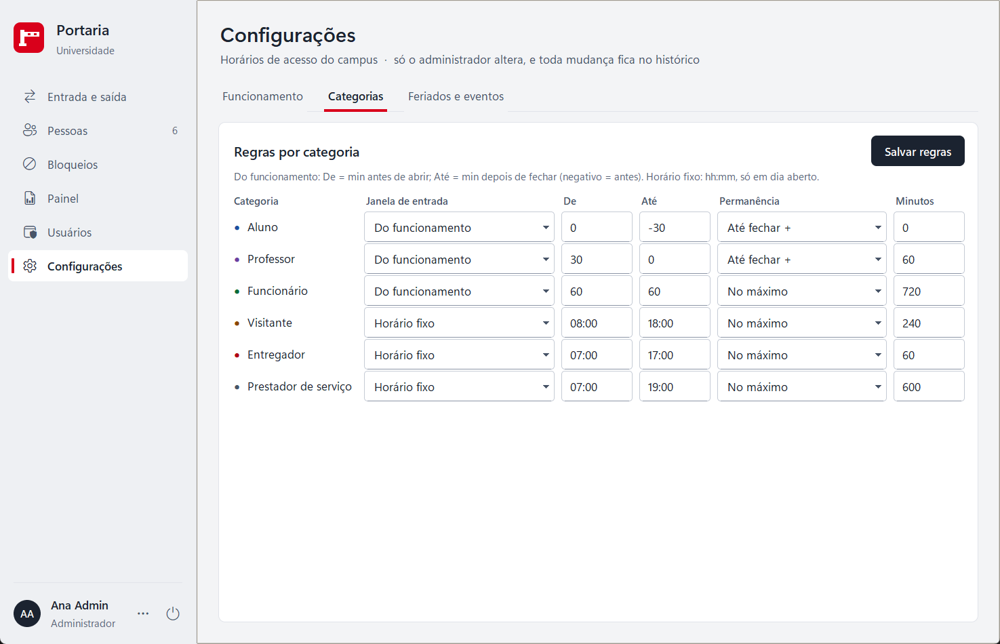
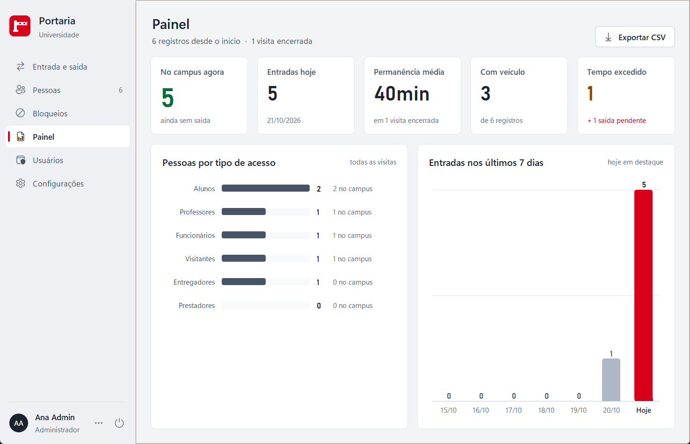

# Sistema de Portaria da Universidade

Projeto da disciplina **Teoria da Computação e Compiladores** (8º período — UNA).
Controle de entrada e saída de pessoas no campus, feito em Python com Tkinter, e
relacionado com as fases de um compilador (léxica, sintática e semântica).

**Versão atual: 2.0** — veja [Versões](#versões).


## Como executar

**Sem instalar nada:** baixe o `Portaria.exe` na página de
[Releases](https://github.com/Kauhan33/sistema-portaria/releases), coloque numa
pasta e abra. O banco, os backups e o log são criados ao lado do `.exe`.

**Pelo código-fonte:** requer só o Python 3 (Tkinter já vem na instalação padrão
do Windows).

```bash
python portaria_universidade.py
```

### Gerar o executável

```bash
pip install pyinstaller
python build_exe.py
```

Gera `dist/Portaria.exe` (arquivo único, sem janela de console, com o ícone da
cancela). O PyInstaller só é necessário para gerar o `.exe`; o programa continua
usando apenas a biblioteca padrão. O ícone fica em `assets/portaria.ico`
(`assets/gerar_icone.py` refaz o ícone, se o símbolo mudar).

Os registros ficam no banco SQLite `portaria.db` (módulo `sqlite3`, já incluso
no Python), criado ao lado do programa. Se houver um `registros_portaria.json` da
versão 1 na mesma pasta, ele é importado na primeira execução e renomeado para
`registros_portaria.json.migrado`, que fica como backup.

### Primeiro acesso e login

Na primeira vez o sistema pede para **criar o administrador** (não existe senha
padrão). Depois disso abre sempre na tela de login.

| Perfil | Pode |
|---|---|
| Porteiro | Registrar entradas e saídas, corrigir registros com entrada nas últimas 24 horas, buscar no histórico, ver e corrigir o cadastro de pessoas, ver a lista de bloqueio e o Painel, trocar a própria senha. Nas tabelas, na ficha da pessoa e na janela Corrigir, vê o CPF mascarado (`***.982.247-**`); ver a exceção em [Segurança e LGPD](#segurança-e-lgpd) |
| Administrador | Tudo do porteiro, com o CPF completo + corrigir registros de qualquer data + **excluir registros** + criar e remover **bloqueios** + **exportar CSV** + página **Usuários** (criar, ativar/desativar, redefinir senha, ver a atividade do sistema) + **autorizar exceções de horário** + **Encerrar o dia** + página **Configurações** (horários de acesso) |

Depois de 5 senhas erradas seguidas o login fica bloqueado por 30 s (o tempo
dobra a cada novo bloqueio, até 15 min). As tentativas ficam no banco: fechar e
abrir o programa não zera o bloqueio (o administrador libera o login ao
redefinir a senha). Sem teclado ou mouse por 10 minutos, a sessão se encerra
sozinha e o sistema volta ao login; uma confirmação que ficou aberta nesse
meio-tempo (ex.: "Excluir registro?") não faz mais nada: aparece "A sessão foi
encerrada. Entre novamente." e o banco também recusa a ação sem um usuário
logado e ativo.

## Testes automatizados

```bash
python -m unittest -v
```

443 testes (biblioteca padrão `unittest`) cobrindo validações, regras de
negócio, login, senhas, permissões, cadastro de pessoas e preenchimento
automático, saída rápida e desfazer, correção de registros, lista de bloqueio,
**regras de horário** (cada categoria dentro e fora da janela, feriados,
eventos, 24 h, retroativo, tempo excedido, saída pendente, autorização do
administrador, encerrar o dia, Configurações), banco de dados, histórico,
migrações, busca, backup, exportação, Painel e a própria tela (preenche campos
e clica nos botões com a janela oculta), inclusive a sessão que expira com uma
confirmação ou a autorização aberta e o tamanho de um notebook 1366×768 a 125%.
Os testes de tela usam um **relógio fixo** (uma quarta-feira às 10:00): o
resultado não depende da hora em que eles rodam.

## Galeria

| | |
|---|---|
|  |  |
| **Login** — painel da guarita com relógio | **Primeiro acesso** — cria o administrador (sem senha padrão) |
|  |  |
| **Entrada e saída** — quem já veio tem os dados preenchidos | **CPF bloqueado** — a entrada é recusada |
|  |  |
| **Visão do porteiro** — CPF mascarado, sem Excluir | **Notebook 1366×768** — layout compacto |
|  |  |
| **Pessoas** — lista e ficha com a placa | **Bloqueios** — CPFs e placas com acesso negado |
|  |  |
| **Painel** — números do dia e gráficos | **Exportar CSV** — só administrador |
|  |  |
| **Usuários** — contas e atividade do sistema | **Corrigir registro** — com o histórico do registro |
|  |  |
| **Regras de horário** — saída pendente, tempo excedido e "fecha em 20 min" | **Autorização do administrador** — exceção pedida pelo porteiro |
|  |  |
| **Configurações** — regras de cada categoria | **Painel** — tempo excedido e saídas pendentes |

**Antes × depois** (a mesma tela na versão 1 e na 2.0):

| Versão 1 | Versão 2.0 |
|---|---|
|  |  |

Todos os prints usam dados fictícios. Mais telas em `docs/design/final/`.

## Telas e funcionalidades

O visual segue o sistema de design **Guarita** (`docs/design/PROPOSTA_DESIGN.md`):
tela calma em tons neutros, um só botão escuro por tela, e cor só quando
importa — verde pode entrar, âmbar atenção, vermelho bloqueado. O vermelho da
UNA aparece como identidade (símbolo, item ativo do menu, painel do login).
Tudo em Tkinter puro: cantos arredondados, botões, placa e gráficos são
desenhados no `Canvas`, os ícones são da fonte Segoe Fluent Icons e o texto
fica nítido em telas com escala de 125% ou 150% (DPI). Num notebook 1366×768
a 125% a página Entrada e saída usa um layout compacto (formulário em duas
linhas, sem a ficha da placa) para a tabela continuar visível. Prints em
`docs/design/final/`.

- **Login**: painel vermelho com o símbolo da cancela e o relógio da guarita;
  à direita, usuário e senha. No primeiro uso, o mesmo layout cria o
  administrador.
- **Barra lateral**: Entrada e saída, Pessoas, Bloqueios, Painel, Usuários e
  Configurações (as duas últimas só para o administrador), com o número de
  pessoas cadastradas e de bloqueios ativos. No
  rodapé, quem está logado, o menu da conta (**Trocar minha senha**, Sair) e o
  botão sair.
- **Entrada e saída** (tecla **Enter** registra a entrada):
  - ao completar o CPF, a faixa de situação diz se a pessoa é nova, já
    cadastrada (nome, celular, placa e tipo se preenchem sozinhos, só nos campos
    vazios), está no campus (com o atalho "Registrar saída") ou está
    **bloqueada** (a entrada será recusada; atalho "Ver bloqueio");
  - à direita, a **placa Mercosul desenhada** acompanha a digitação (fica
    vermelha se a placa estiver bloqueada) e o histórico da pessoa (visitas,
    última vinda, tipo);
  - o relógio dentro dos campos de data põe a hora de agora;
  - **Saída rápida** no topo (atalho **F2**): CPF ou placa exatos + Enter;
    pergunta antes se a placa trouxer mais de uma pessoa (carona);
  - tabela **Movimento**: as entradas e saídas de hoje e todo mundo que
    ainda está no campus; com texto na busca, procura no **histórico inteiro**
    (nome, CPF, celular, placa ou tipo). A situação de cada visita: no campus,
    saiu, **Tempo excedido** (âmbar) ou **Saída pendente** (vermelho, em
    destaque). Duplo clique ou "Registrar saída" dão a saída (aceita várias
    linhas); o aviso com **Desfazer** fica 10 segundos no rodapé;
  - faixas no topo, só quando importam: **saídas pendentes** (o administrador
    tem o atalho **Encerrar o dia**) e, nos últimos 30 minutos antes de
    fechar, **"Campus fecha às 23:00 (em 20 min) · 5 no campus"** (sem caixa
    de diálogo, não atrapalha o uso);
  - "Corrigir" abre a janela **Corrigir registro** (mesmas validações do
    cadastro; o histórico guarda o que mudou e quem mudou); "Excluir" só
    aparece para o administrador (RN02).
- **Pessoas**: lista com busca e situação (no campus, fora, bloqueado) e a
  **ficha** da pessoa escolhida: placa, visitas, faixa de bloqueio, correção dos
  dados e "Registrar entrada" (abre a Entrada e saída já preenchida).
- **Bloqueios**: CPFs e placas com acesso negado e o motivo. Todos veem; só o
  administrador cria ("Novo bloqueio") ou remove — remover não apaga, guarda
  quem removeu e quando ("Mostrar removidos").
- **Painel**: no campus agora, entradas de hoje, permanência média, com
  veículo e **tempo excedido** (com as saídas pendentes logo abaixo); gráficos de pessoas por tipo e das entradas dos últimos 7 dias (hoje
  em destaque). O administrador **exporta para CSV** (Excel) os registros de um
  período.
- **Usuários** (administrador): contas (criar em diálogo, ativar/desativar,
  redefinir senha) e a atividade do sistema com filtro.
- **Configurações** (administrador): os horários de acesso, em três seções —
  **Funcionamento** (abre e fecha de cada dia da semana, minutos do aviso
  antes de fechar e o limite da entrada retroativa), **Categorias** (janela de
  entrada e permanência máxima de cada tipo de acesso) e **Feriados e eventos**
  (adicionar e remover). Tudo é validado (hh:mm válido, fechamento depois da
  abertura, números nos limites) e cada mudança fica no histórico.

### Regras de horário de acesso

Padrão do campus (tudo editável em Configurações): **segunda a sexta 06:30–23:00,
sábado 07:00–14:00, domingo fechado**. Um **feriado** fecha o campus no dia; um
**evento** (ex.: formatura num sábado 18:00–23:00, ou num domingo) substitui o
horário daquela data, mesmo em feriado ou domingo.

| Categoria | Pode entrar | Permanência máxima |
|---|---|---|
| Aluno | no funcionamento, até 30 min antes de fechar | até o fechamento |
| Professor | de 30 min antes de abrir até o fechamento | até o fechamento + 1 h |
| Funcionário | de 1 h antes de abrir até 1 h depois de fechar | 12 h |
| Visitante | 08:00–18:00, só em dia de funcionamento | 4 h |
| Entregador | 07:00–17:00, só em dia de funcionamento | 1 h |
| Prestador de serviço | 07:00–19:00, só em dia de funcionamento | 10 h |

- **Exceções** (pedem a autorização do administrador): entrada com o campus
  fechado ou fora da janela da categoria, entrada retroativa com mais de 12 h
  e qualquer visita com mais de **24 h**. Vale ao registrar a entrada, dar a
  saída (botão, duplo clique ou saída rápida) e corrigir um registro (só o que
  mudou é conferido de novo).
- **Autorização do administrador**: um diálogo lista as regras violadas e pede
  a **justificativa** (obrigatória). Com o porteiro logado, um administrador
  digita o login e a senha dele (senha oculta; errar conta como tentativa de
  login). Com o administrador logado, basta confirmar com a justificativa. O
  histórico grava a **"Exceção autorizada"** com quem autorizou, quem operava,
  as regras e o porquê, ligada à visita. Se a sessão expirar com o diálogo
  aberto, nada é gravado. O banco confere de novo: visita acima de 24 h sem a
  autorização de um administrador ativo é recusada.
- **Tempo excedido**: visita aberta acima da permanência máxima da categoria
  (âmbar no Movimento e um número no Painel). É só um alerta.
- **Saída pendente**: quem não teve a saída registrada até o fechamento do dia
  da entrada (nunca antes do fim da permanência permitida: o professor pode
  ficar até 24:00). É calculada com o relógio, não depende de o programa estar
  aberto às 23:00.
- **Encerrar o dia** (administrador): dá a saída de todas as pendentes, de uma
  vez, no horário de fechamento do dia de cada entrada, depois de confirmar;
  cada uma fica no histórico como "Saída automática (encerramento)".

Regras e segurança:

- Validações no padrão brasileiro: CPF com dígitos verificadores, celular com
  DDD válido e 9, placa antiga (ABC1234) ou Mercosul (ABC1D23); nome completo só
  com letras. CPF, celular e placa só aceitam o que cabe no formato, em todas as
  telas.
- Entrada e saída não podem estar no futuro; a saída não pode ser anterior à
  entrada; o mesmo CPF não pode estar no campus duas vezes ao mesmo tempo
  (conferido com todas as visitas daquele CPF no banco).
- O banco também barra CPF incompleto, saída anterior à entrada e duas visitas
  abertas do mesmo CPF; cada operação é uma transação.
- Senha guardada só como hash PBKDF2-SHA256 com sal (RNF02); histórico de ações
  com CPFs mascarados.
- Ao abrir, o programa faz o **backup do dia** (pasta `backups`, guarda os 30
  mais recentes). Avisos da atualização do banco ou de backup que falhou
  aparecem ao administrador. Erros técnicos vão para `portaria.log`; o usuário
  vê só uma mensagem simples.

## Segurança e LGPD

O sistema guarda dados pessoais (nome, CPF, celular, placa e horários de
entrada e saída). Tudo fica no próprio computador, na pasta do programa
(onde está o `portaria_universidade.py` ou o `.exe`):

| Arquivo | O que tem |
|---|---|
| `portaria.db` (e, com o programa aberto, `portaria.db-wal` e `portaria.db-shm`) | O banco: pessoas, visitas, usuários (senha só como hash), histórico de ações, bloqueios e tentativas de login |
| `backups/portaria-AAAA-MM-DD.db` | Cópia do banco feita ao abrir o programa, uma por dia; ficam as 30 mais recentes |
| `backups/portaria-antes-vX-de-vN-....db` | Cópia feita antes de atualizar o banco para uma versão nova. **Não é apagada sozinha**: apague à mão quando a atualização estiver conferida |
| `portaria.log` (e `.1` a `.3`) | Só erros técnicos (até 3 × 1 MB). Não guarda CPF, celular nem senha |
| CSV exportado | Fica onde o administrador escolher no "Salvar como". Leva **CPF e celular completos** e a exportação fica no histórico |
| `registros_portaria.json.migrado` | Só se havia a versão 1: os registros antigos, em texto |

**Os backups têm tudo o que o banco tem**, inclusive os hashes de senha e os
registros que já foram excluídos no programa (um registro excluído hoje
continua nos backups diários por até 30 dias, e nos `portaria-antes-...` até
alguém apagá-los). Trate a pasta de backups com o mesmo cuidado do banco.

**Quem deve ter acesso** (recomendação para instalar na portaria):

- a pasta do programa e a pasta `backups` só com acesso da conta do Windows
  usada na portaria e do administrador (Propriedades → Segurança no
  Explorador de Arquivos); o porteiro não deve ser administrador do Windows;
- disco com **BitLocker** ligado, para os dados não serem lidos se o
  computador ou o disco for levado;
- de tempos em tempos, uma cópia da pasta `backups` em outro disco (pendrive
  ou HD externo guardado com o administrador): backup no mesmo disco não
  protege contra a falha do disco;
- CSV exportado: guardar em pasta restrita e apagar quando não for mais útil.

**Privacidade na tela:** o porteiro vê o CPF mascarado (`***.982.247-**`) nas
tabelas, na ficha da página Pessoas e na janela Corrigir (o lápis do campo
deixa digitar um CPF novo, sem mostrar o antigo). **Exceção:** em Pessoas →
"Registrar entrada", o CPF completo vai para o campo CPF da Entrada e saída,
porque é o dado necessário para registrar a entrada. O celular aparece
completo na ficha da pessoa (é o campo para corrigi-lo). O histórico de ações
grava os CPFs mascarados (o celular aparece completo quando uma correção o
altera).

**Como restaurar um backup** (ex.: o programa avisa que o banco está
danificado):

1. Feche o programa em todos os computadores que usam esse banco.
2. Na pasta do programa, renomeie `portaria.db` para
   `portaria-danificado.db` (não apague: pode ser útil depois). Se existirem
   `portaria.db-wal` e `portaria.db-shm`, renomeie também (ex.:
   `portaria-danificado.db-wal`), para não serem misturados com a cópia.
3. Abra a pasta `backups` e escolha o backup mais recente que estava bom
   (o nome tem a data: `portaria-2026-10-20.db`).
4. Copie esse arquivo para a pasta do programa e renomeie a cópia para
   `portaria.db`.
5. Abra o programa e confira os registros. O que foi feito depois da data do
   backup não está nele e precisa ser lançado de novo.

**Limitações conhecidas** (registradas para as próximas versões):

- O banco e os backups não são criptografados pelo programa: quem consegue
  abrir a pasta lê os dados. A proteção depende das permissões do Windows e
  do BitLocker (item S02 da auditoria de segurança).
- O histórico de ações não tem trava contra alteração: quem abre o arquivo do
  banco com outra ferramenta consegue apagar linhas sem deixar rastro (S10).
- Ainda não há prazo de retenção nem "anonimizar pessoa": excluir uma visita
  não apaga o cadastro da pessoa, e os dados ficam até alguém excluí-los.

## Estrutura da pasta

| Caminho | Conteúdo |
|---|---|
| `portaria_universidade.py` | Ponto de entrada (é o arquivo que se executa) e a relação com Compiladores |
| `portaria/validacao.py` | Regras de CPF, celular, placa, nome, datas e verificações semânticas |
| `portaria/horarios.py` | Regras de horário de acesso (funções puras): funcionamento, feriados, eventos, categorias, exceções, situação da visita |
| `portaria/dados.py` | Banco SQLite (pessoas, visitas, usuários, histórico, bloqueios) e migrações |
| `portaria/consultas.py` | Busca e números do Painel (versão em Python, usada nos testes) |
| `portaria/usuarios.py` | Senhas (hash), perfis, permissões, login e troca de senha |
| `portaria/backup.py` | Backup do banco e exportação para CSV |
| `portaria/estilo.py` | Tokens do design: cores, fontes, ícones, medidas, escala (DPI) e estilos ttk |
| `portaria/componentes.py` | Peças de tela: cartão, botões, campo, faixa de aviso, placa, tabela, diálogo |
| `portaria/mensagens.py` | Caixas de mensagem e "Salvar como" |
| `portaria/interface.py` | Janela principal, barra lateral, sessão e o contrato que as telas usam |
| `portaria/tela_login.py` | Login e primeiro acesso |
| `portaria/tela_cadastro.py` | Entrada e saída (formulário, saída rápida, Movimento) |
| `portaria/tela_pessoas.py` | Pessoas (lista e ficha) |
| `portaria/tela_bloqueios.py` | Bloqueios |
| `portaria/tela_dashboard.py` | Painel e exportação; `graficos.py` desenha as barras |
| `portaria/tela_usuarios.py` | Usuários e atividade (só administrador) |
| `portaria/tela_edicao.py` | Janela "Corrigir registro" com o histórico do registro |
| `portaria/tela_autorizacao.py` | Diálogo "Autorização do administrador" (exceções de horário) |
| `portaria/tela_configuracoes.py` | Configurações dos horários de acesso (só administrador) |
| `portaria/tela_senha.py` | Janela "Trocar minha senha" |
| `docs/design/` | Proposta de design, protótipo e prints (antes, protótipo e final) |
| `docs/revisao/` | Relatórios das revisões de segurança, código e backend (antes e depois da reforma) |
| `build_exe.py` | Gera o `dist/Portaria.exe` com o PyInstaller |
| `assets/` | Ícone do programa (`portaria.ico`) e o script que o gera |
| `tests/` | Testes automatizados |
| `IDEIAS_E_MELHORIAS.md` | Análise do código, falhas encontradas e roteiro de melhorias |
| `versoes/v1_original/` | Cópia da versão feita no Claude gratuito, para comparar antes × depois |
| `material_aula/` | Slides da disciplina (enunciado do exercício e guia de documentação) — local, fora do git |
| `entrega/` | O que vai para a faculdade (Word com capa, prints, .exe) — local, fora do git |

## Versões

**2.1** (em desenvolvimento) — regras de horário de acesso:

- funcionamento por dia da semana, feriados e eventos; janela de entrada e
  permanência máxima por categoria; limite geral de 24 h;
- exceções com **autorização do administrador** (login e senha, justificativa,
  histórico "Exceção autorizada"), conferidas também no banco;
- situação **Tempo excedido** e **Saída pendente**, faixas de alerta, aviso
  antes de fechar, **Encerrar o dia** e o número novo no Painel;
- página **Configurações**; banco na versão 7 (migração com backup antes);
- correção: a visita com entrada em outro dia e saída hoje sumia do Movimento;
- 443 testes automatizados.

**2.0** (20/10/2026) — reforma completa, feita com um time de agentes de IA
(design, segurança, código, backend) e revisada antes de publicar:

- visual novo "Guarita" (barra lateral, login com relógio, texto nítido em
  telas com escala, layout compacto para notebook);
- tela principal rápida mesmo com anos de dados (só o movimento do dia + quem
  está no campus; a busca procura no histórico inteiro);
- regras garantidas também no banco (uma entrada aberta por CPF, permissões),
  migrações seguras com backup antes;
- backup diário automático, exportação para CSV e log de erros;
- login mais seguro (tentativas gravadas, espera crescente, senha mínima de 8,
  troca da própria senha, sessão que expira por inatividade);
- privacidade: CPF mascarado para o porteiro e no histórico;
- correções achadas na revisão final (ação após a sessão expirar, notebook
  1366×768, saída em linha desatualizada, falha de backup);
- executável `Portaria.exe` e 359 testes automatizados.

Relatórios e decisões: `docs/revisao/` e `docs/design/PROPOSTA_DESIGN.md`.

**1.x** (16 a 17/10/2026) — organização da versão feita no Claude gratuito:
módulos e testes, SQLite, login, cadastro de pessoas, saída rápida, correção de
registro e lista de bloqueio. A versão original, de um arquivo só, está em
`versoes/v1_original/`.
